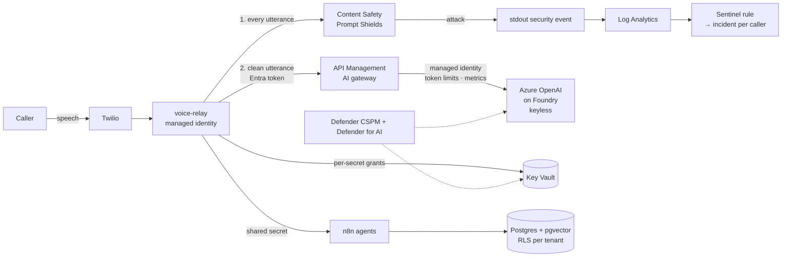

# Securing ClarityOS

**How I found and fixed the security problems in a production multi-agent AI receptionist, using the Microsoft AI security stack.**

Azure OpenAI on Foundry · Azure API Management AI gateway · Prompt Shields · Microsoft Sentinel · Defender for Cloud (CSPM + AI) · Key Vault · Entra ID · Terraform

---

## The system

ClarityOS answers calls and texts for small businesses. Three agents share one platform:

| Agent | Runs on | Talks to |
|---|---|---|
| **Voice** (voice-relay) | App Service | Twilio, Content Safety, Azure OpenAI via API Management (booking-intent classification), Claude Haiku, Cal.com bookings |
| **SMS** | n8n on Container Apps | Twilio, the knowledge-base agent |
| **Knowledge base** | n8n on Container Apps | Voyage embeddings + pgvector search over each customer's uploaded documents (retrieval-augmented generation), Claude Sonnet for the answer |

Customers are separate tenants in one Postgres database. The platform itself is documented in **[clarity-platform-foundation](https://github.com/michaeledwards0/clarity-platform-foundation)**.

## Architecture (AI path)



## Three phases

| Phase | Summary | Doc |
|---|---|---|
| **1. Find** | An infrastructure review of my own production system, mapped to the OWASP Top 10 for LLM Applications (2025). Eight findings, including one where anyone who found the n8n hostname could read any tenant's knowledge base. | [phase-1-find](docs/phase-1-find.md) |
| **2. Fix** | Per-agent identities with per-secret Key Vault grants, authentication between agents, a pinned container image, keyless AI services, an Azure OpenAI model behind an API Management AI gateway with per-agent token limits | [phase-2-fix](docs/phase-2-fix.md) |
| **3. Detect** | Prompt Shields on caller input feeding a Sentinel analytics rule that opens one incident per caller, a fail-open alert, Defender CSPM with AI security posture management, Defender for AI with prompt evidence | [phase-3-detect](docs/phase-3-detect.md) |

The before/after results are in the **[scorecard](scorecard.md)**, mapped to OWASP LLM Top 10 (2025) and NIST AI RMF.

## Findings at a glance

| # | Finding | OWASP | Status |
|---|---|---|---|
| 1 | Caller speech reached the model unfiltered | LLM01 | Fixed (voice) |
| 2 | Every agent identity could read every Key Vault secret; the voice agent could read the Stripe key | LLM06 | Fixed |
| 3 | n8n connected to Postgres as an RLS-bypassing admin | LLM06 | Fixed |
| 4 | Unauthenticated webhooks let anyone read any tenant's knowledge base | LLM02 / LLM08 | Fixed |
| 5 | n8n ran `:latest` and applied schema migrations nobody chose | LLM03 | Fixed |
| 6 | Model answers built into JSON by string interpolation | LLM05 | Fixed |
| 7 | No per-agent token limits on model calls | LLM10 | Fixed (AI gateway) |
| 8 | Uploaded KB documents reach the model unscreened (indirect injection) | LLM01 | Open |

## Repo layout

```
docs/          phase write-ups
scorecard.md   OWASP LLM Top 10 / NIST AI RMF before-and-after
terraform/     production Terraform (excerpts and modules, identifiers removed)
apim/          AI gateway policy
kql/           Sentinel and alert queries
src/           Prompt Shields client and the least-privilege Postgres role
screenshots/   evidence, one folder per phase
```

## What's next

- Prompt Shields on SMS input and on uploaded KB documents (indirect injection)
- AI red teaming with PyRIT / the Foundry AI red teaming agent, including booking-tool abuse
- Groundedness detection on knowledge-base answers (LLM09)
- Operator's standing Key Vault access → PIM-eligible

---

Michael Edwards · Founder & Cloud/AI Security Engineer, Clarity Process Group · [LinkedIn](https://linkedin.com/in/michael-edwards-cloud)
